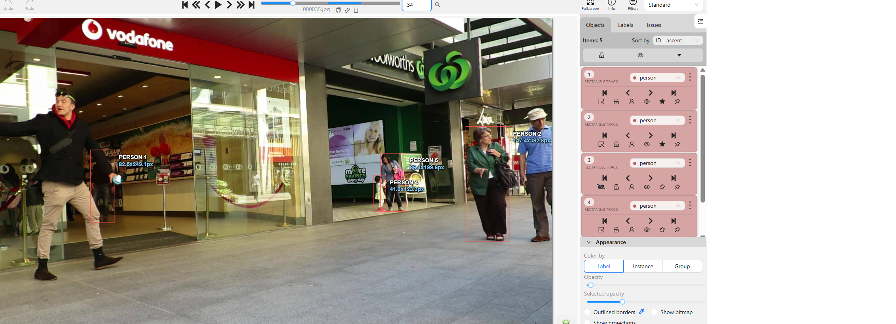
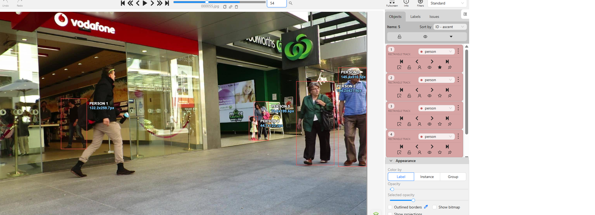
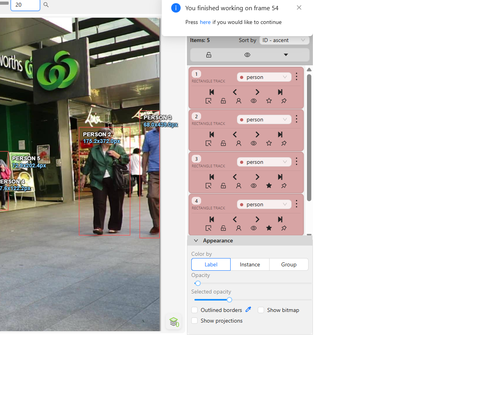
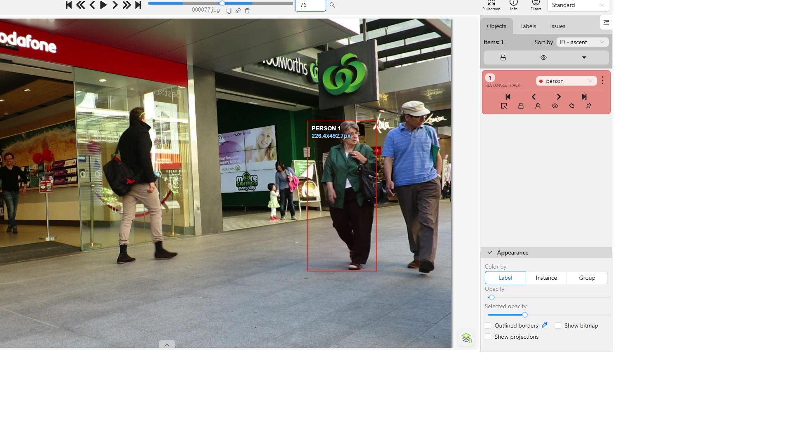
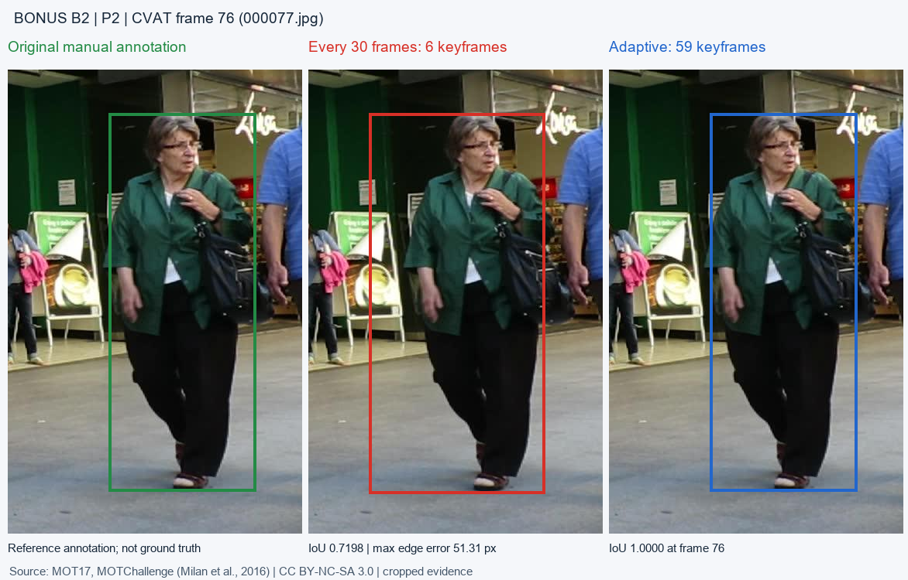

# Báo cáo cá nhân — NgoThiMinhQuang — 2A202603146

**Bài thực hành Ngày 5: Gán track ID bằng keyframe và nội suy trong CVAT.**

Dữ liệu: MOT17-09, 150 frame, 1920 × 1080, 30 fps. Nguồn: MOT17, MOTChallenge (Milan et al., 2016), giấy phép CC BY-NC-SA 3.0. Toàn bộ số frame trong báo cáo theo CVAT **0–149**; trong MOT, frame_id = frame CVAT + 1.

## 0. Thông tin học viên

- Họ tên: NgoThiMinhQuang.
- MSSV: **2A202603146**.
- Mã đề: **B**; xác nhận bằng `setup_local_lab.py --mssv 2A202603146 --assignment-only`.
- Email: minhquang17012005@gmail.com.
- Repository: [K5-L2-DAY05-NgoThiMinhQuang-2A202603146-MOTTracking](https://github.com/NgoThiMinhQuang/K5-L2-DAY05-NgoThiMinhQuang-2A202603146-MOTTracking).
- Bài chính: [task 24 / job 24](http://localhost:8080/tasks/24/jobs/24), `DAY05-MOT17-09-B-2A202603146`.
- Bonus B2: [task 25 / job 25](http://localhost:8080/tasks/25/jobs/25).
- Giờ bắt đầu: **16:00 ngày 13/11/2026 (GMT+7)**.
- Giờ kết thúc buổi làm: **19:30 ngày 13/11/2026**, tổng **210 phút**.
- Rà soát, sửa lỗi và xuất bản cuối: **14/11/2026**. Thời gian 210 phút là thời gian buổi làm ban đầu, không bao gồm phần hỗ trợ sau đó.

## 1. Xem trước đoạn video (CP0)

Bài theo dõi đúng 5 người của đề B, dùng nhãn `person`, công cụ Rectangle ở chế độ Track. Player step = 10; bật auto save, hiện ID/nhãn và hiển thị track ngoài khung trong panel Objects. Không còn track demo trong bài chính.

Bảng dưới được hoàn thiện từ lần xem lại ngày 14/11; không còn nhật ký trước khi vẽ để đối chiếu thời điểm ghi ban đầu.

| Mã | Frame xuất hiện | Frame cuối thấy được | Rẽ / dừng / đổi tốc độ ở frame | Bị che ở frame | Ghi chú |
|---|---:|---:|---|---|---|
| P1 | 0 | 149 | Khoảng 54–90 đổi hướng thân và bước đi sau đoạn che | Occluded 35–41, 44–53; outside 42–43 | Áo tối màu, quần jeans, trong cửa hàng; không nhầm với người đi trước |
| P2 | 0 | 149 | Đoạn 60–90 có dịch chuyển ngang không đều; kích thước tăng khi lại gần | Không bật occluded | Áo xanh lá, quần tối màu; đối tượng làm B2 |
| P3 | 0 | 149 | 0–39 vào dần từ mép phải; 40–149 tiến gần camera | Không bật occluded | Áo xanh dương, đội mũ; phần ngoài ảnh được cắt ở biên |
| P4 | 0 | 147 | Chủ yếu ở nền; khoảng 20–40 thay đổi tư thế tay/chân | Occluded 105–110, 136–138, 143–147; outside 111–135 | Trẻ mặc váy xanh nhạt; outside từ 148 |
| P5 | 2 | 105 | Chủ yếu ở nền, ít thay đổi vị trí | Occluded 92–105 | Áo xanh xám, túi hồng; outside 0–1 và từ 106 |

P1–P5 của đề B tương ứng identity tham chiếu **1, 19, 20, 21, 22** trong bảng phân đề. Các số này không phải ID trong file xuất.

| Mã | Object CVAT | Track XML | Track MOT trong bản xuất cuối |
|---|---:|---:|---:|
| P1 | 1 | 0 | 1 |
| P2 | 2 | 1 | 2 |
| P3 | 3 | 2 | 3 |
| P4 | 4 | 3 | 4 |
| P5 | 5 | 4 | 5 |

ID MOT được đánh lại khi xuất. Sau khi bổ sung P3 ở đầu đoạn, thứ tự MOT thay đổi so với bản 635 box cũ; bảng này chỉ áp dụng cho ZIP cuối.

## 2. Keyframe và thời gian (CP1, CP4)

Số keyframe lấy từ script lớp, chỉ đếm mốc có `outside=0`. Thời gian từng người không được ghi riêng nên giữ nguyên là “Không ghi riêng”, không chia ngược tổng thời gian thành số liệu giả.

| Mã | Số keyframe | Keyframe ở frame | Số frame có mặt | Keyframe / 100 frame | Thời gian (phút) | Chỗ khó |
|---|---:|---|---:|---:|---|---|
| P1 | 50 | Xem danh sách dưới | 148 | 33.8 | Không ghi riêng | Che khuất bởi người đi phía trước, giữ ID khi hiện lại |
| P2 | 59 | Xem danh sách dưới | 150 | 39.3 | Không ghi riêng | Lại gần camera; box tăng kích thước và dịch chuyển không đều |
| P3 | 47 | Xem danh sách dưới | 150 | 31.3 | Không ghi riêng | Thấy một phần ở mép phải từ đầu; cần giữ box trong khung |
| P4 | 34 | Xem danh sách dưới | 123 | 27.6 | Không ghi riêng | Người nhỏ ở nền, bị người phía trước che |
| P5 | 38 | Xem danh sách dưới | 104 | 36.5 | Không ghi riêng | Người ở nền bị bàn tay/thân người phía trước che |
| **Tổng** | **228** | | **675** | **33.8** | **210 cho buổi làm ban đầu** | |

Keyframe / 100 frame cả bài = 228 / 675 × 100 = **33.8**.

P2 có nhiều keyframe nhất (**59**). Người này vừa tiến lại gần vừa dịch chuyển ngang không đều; nếu chỉ đặt mốc thưa, box dễ đi trước người như kết quả B2 ở frame 76.

| Mã | Keyframe ban đầu | Sau rút gọn | Bản cuối sau rà soát ảnh |
|---|---:|---:|---:|
| P1 | 119 | 50 | 50 |
| P2 | 145 | 59 | 59 |
| P3 | 99 | 42 | 47 |
| P4 | 33 | 33 | 34 |
| P5 | 37 | 37 | 38 |
| **Tổng** | **433** | **221** | **228** |

Các mốc dư của P1–P3 được rút gọn bằng kiểm tra nội suy: giữ tọa độ mốc cũ, bảo toàn ID và các mốc đổi cờ. Trên những frame đã có annotation, bản rút gọn lệch cạnh tối đa 6 pixel, IoU ít nhất 0.95 so với bản ban đầu. Đây là so với annotation cũ, không phải GT. Sau đó bổ sung 5 mốc cho P3 tại 0, 10, 20, 30, 39 và hai mốc cờ cho P4/P5 ở 105/92. Vì thế số liệu cuối là 228 keyframe và 675 box.

Bảng chi tiết: [keyframe_truoc_sau.csv](keyframe_truoc_sau.csv).

<details>
<summary>Danh sách keyframe bản cuối, theo frame CVAT</summary>

- **P1:** 0, 2, 8, 11, 12, 13, 15, 17, 18, 26, 28, 30, 32, 33, 34, 35, 37, 39, 44, 47, 48, 49, 50, 52, 53, 54, 57, 61, 62, 64, 67, 73, 77, 83, 84, 88, 92, 95, 97, 100, 102, 110, 113, 121, 125, 135, 136, 140, 144, 149.

- **P2:** 0, 2, 7, 11, 13, 19, 22, 25, 26, 29, 34, 43, 45, 47, 51, 52, 55, 56, 58, 59, 62, 63, 71, 76, 79, 83, 88, 91, 95, 98, 101, 103, 105, 106, 108, 110, 113, 114, 115, 116, 117, 118, 119, 121, 122, 125, 126, 127, 129, 131, 133, 134, 135, 140, 141, 142, 144, 147, 149.

- **P3:** 0, 10, 20, 30, 39, 40, 45, 49, 56, 62, 63, 68, 71, 72, 80, 85, 89, 91, 93, 96, 99, 104, 107, 111, 112, 114, 116, 119, 121, 122, 126, 127, 129, 131, 132, 134, 135, 137, 138, 139, 140, 141, 142, 143, 145, 147, 148.

- **P4:** 0, 1, 2, 3, 4, 5, 6, 7, 8, 9, 10, 11, 12, 13, 14, 15, 17, 18, 19, 20, 22, 25, 29, 30, 32, 35, 36, 39, 50, 105, 107, 136, 139, 143.

- **P5:** 2, 3, 4, 5, 6, 7, 8, 9, 10, 11, 12, 15, 18, 19, 22, 23, 24, 27, 30, 32, 33, 34, 36, 37, 45, 50, 53, 54, 56, 59, 63, 92, 96, 98, 100, 101, 102, 103.

</details>

## 3. Đoạn bị che (CP2)

Người xử lý đoạn che: **P1**, object CVAT **1**, track XML **0**, track MOT **1**.

| Mốc | Frame |
|---|---:|
| Bắt đầu bị che một phần — bật `occluded` | 35 |
| Mất hẳn — bật `outside` | 42 |
| Hiện lại — tắt `outside`, còn `occluded` | 44 |
| Thấy rõ trở lại — tắt `occluded` | 54 |

- Thời gian khuất hẳn: **2 frame**, từ 42 đến 43, bằng **2/30 ≈ 0.067 giây**.
- Quyết định: **giữ cùng track, cùng ID**.
- Lý do: khoảng khuất ngắn hơn ngưỡng 60 frame; người mặc áo tối màu, quần jeans xuất hiện lại ở vùng cửa hàng liền với vị trí trước khi bị che. Diễn biến trước/sau phù hợp với người đang đi trong cửa hàng, khác người áo đen/quần sáng đi phía trước.
- Khi chỉ bị che một phần, box vẫn ước lượng toàn thân. Khi khuất hẳn, bật outside để ngừng xuất box, không xóa track và không tạo ID mới.






Nguồn ba ảnh: **MOT17, MOTChallenge (Milan et al., 2016)**. Ảnh chụp CVAT local trong lần rà soát ngày 14/11/2026.

## 4. Tự review ID (CP3)

Lần rà soát cuối ngày 14/11 được thực hiện với hỗ trợ Codex. Lượt 1 xem ảnh từng track theo thứ tự **149 → 0**, đủ 150 frame/người, kèm trạng thái outside/occluded. Lượt 2 xem toàn cảnh tại **0, 10, …, 140, 149**, rồi phóng vùng nghi vấn để kiểm tra từng frame. Các mốc sửa được kiểm tra lại trên job CVAT và file xuất. Đây là nhật ký rà soát có hỗ trợ, không khai là hai lượt học viên tự làm trong buổi 13/11.

| Frame | Mã người | Loại lỗi | Mô tả một câu | Phát hiện ở lượt | Đã sửa? |
|---:|---|---|---|---|---|
| 0–39 | P3 | `lost` | Người áo xanh đã thấy một phần ở mép phải nhưng track cũ đặt outside đến 39 | 2, kiểm tra lại ảnh từng frame 0–40 | Có: bổ sung mốc 0, 10, 20, 30, 39; giữ object 3 |
| 92–99 | P5 | `flag` | Người ở nền đã bị che một phần nhưng cờ occluded cũ chỉ bật từ 100 | 1, đối chiếu toàn cảnh đoạn 90–105 | Có: bật occluded từ 92, không đổi outside 106 |
| 105–106 | P4 | `flag` | Tay người phía trước che một phần trẻ nhưng cờ occluded cũ bắt đầu từ 107 | 1, kiểm tra phóng vùng 100–110 | Có: bật occluded từ 105, giữ outside 111 |

Tổng hợp **lỗi phát hiện trong lần rà soát**, không phải số đo từ GT:

| `id_switch` | `fragmentation` | `lost` | `merge` | `false_track` | `drift` | `flag` |
|---:|---:|---:|---:|---:|---:|---:|
| 0 | 0 | 1 | 0 | 0 | 0 | 2 |

Lỗi P3 dễ thấy hơn ở lượt theo cảnh: nếu chỉ nhìn các crop nơi đã có box, toàn bộ 0–39 sẽ hiện “outside” nên có thể bỏ qua người thật ở mép phải. Nhìn toàn cảnh cho thấy người vẫn đang trong ảnh. Vì vậy không thể dùng kết quả 0 lỗi của script để thay thế xem ảnh.

Sau sửa, chưa phát hiện thêm ID nhảy sang người khác trong lần kiểm tra ảnh. Điều này không thay thế kết quả chấm IDSW/Frag bằng GT của coach. Độ chính xác tuyệt đối của các box mới P3 tại biên ảnh vẫn cần đối chiếu theo quy ước box của lớp.



Nguồn ảnh: **MOT17, MOTChallenge (Milan et al., 2016)**, ảnh chụp CVAT local.

## 5. File xuất và kết quả tự kiểm (CP4)

| Kiểm tra | Kết quả |
|---|---|
| Tên file MOT 1.1 | [NgoThiMinhQuang_mot.zip](../../src/exports/NgoThiMinhQuang_mot.zip) |
| Tên file CVAT for video 1.1 | [NgoThiMinhQuang_cvat_video.zip](../../src/exports/NgoThiMinhQuang_cvat_video.zip) |
| Số track ID khác nhau trong gt/gt.txt | **5**, tổng **675 box** |
| Frame outside không có dòng trong gt.txt | **Đúng**, đã đối chiếu tập frame theo từng track |
| Hai định dạng xuất | Khớp tọa độ, trạng thái hiện/vắng theo ánh xạ ID của bản cuối |
| Save images | **Không bật**; các ZIP không chứa ảnh/video |
| Job đã completed trên CVAT máy cá nhân | **Có**: job 24 và job bonus 25 có status/state `completed` |
| Script tự kiểm | **0 lỗi, 0 cảnh báo**, 228 keyframe / 675 frame có mặt |

Lệnh kiểm từ thư mục gốc repo:

```powershell
.\.venv\Scripts\python.exe src/check_submission.py --mot src/exports/NgoThiMinhQuang_mot.zip --cvat src/exports/NgoThiMinhQuang_cvat_video.zip
```

```text
=== Tóm tắt ===
  Lỗi: 0   |   Cảnh báo: 0
  Đạt. Dán phần tóm tắt này vào báo cáo mục 5.
```

Kết quả đầy đủ: [ket_qua_tu_kiem.txt](ket_qua_tu_kiem.txt).

**Khó khăn và cách khắc phục:** bản đầu có keyframe quá dày và thiếu P3 ở 40 frame đầu. Đã sao lưu, giảm mốc dư, xem lại ảnh, sửa lỗi và xuất lại. Tổng box tăng từ 635 lên 675 do bổ sung 40 frame cho P3; không phải tạo thêm người. Không có thời gian ghi riêng từng track nên chỉ báo tổng thời gian buổi làm. Không tính MOTA/IDF1 vì phép tự kiểm không có GT.

## 6. Ba câu kết

1. **Nếu được gán lại, em sẽ đặt keyframe khác ở đâu? Vì sao?**

   Em sẽ xem kỹ mép ảnh từ đầu để tránh bỏ sót P3, đồng thời giảm việc đặt keyframe liên tiếp ở đoạn đã nội suy tốt. Với P1 cần giữ các mốc quanh che khuất 35, 42, 44, 54. Với P2 cần kiểm tra kỹ đoạn 60–90 vì vị trí và kích thước thay đổi không đều; thử nghiệm B2 cho thấy chỉ nối frame 60 với 90 làm cạnh box lệch hơn 51 pixel ở frame 76.

2. **Có chỗ nào cần cân nhắc cùng ID hay ID mới? Em quyết định và ghi chú thế nào?**

   Đoạn P1 bị khuất ở 42–43 rồi hiện lại ở 44 là chỗ cần kiểm tra. Bài giữ cùng ID vì chỉ khuất 2 frame, dưới ngưỡng 60, và ngoại hình/vùng xuất hiện lại phù hợp với người trước đó. Các mốc bật/tắt outside và occluded được ghi ở mục 3, kèm ảnh trước, giữa và sau đoạn che. Không dùng riêng màu áo để kết luận vì người đi phía trước cũng mặc tối màu.

3. **Một lỗi ID trong job có thể làm xe tự lái dự đoán sai chuyển động thế nào? Ảnh hưởng MOTA hay IDF1 nhiều hơn?**

   Lỗi thực tế đã sửa là `lost` của P3 ở 0–39: người đã thấy trong ảnh nhưng chưa có box. Nếu dùng nhãn này làm dữ liệu, hệ thống có thể học thiếu tình huống người vừa vào mép khung và nhận biết người muộn hơn. Lỗi này làm tăng FN, nên tác động trực tiếp vào MOTA; IDF1 cũng có thể giảm vì thiếu các lần nhận diện đúng. Không có GT để kết luận mức giảm cụ thể hoặc khẳng định chỉ số nào giảm nhiều hơn. Nếu còn đổi nhầm ID giữa hai người thì lịch sử chuyển động cũng bị nối sai, dễ làm ước lượng hướng và vận tốc sai.

## Bonus (nếu làm)

### B1 — Hai người đi sát

Không thực hiện. Bài chính giữ đúng 5 track của đề B.

### B2 — So cách đặt keyframe

Đối tượng: **P2**, người áo xanh lá, object **2** trong job chính [24](http://localhost:8080/tasks/24/jobs/24). Phương án đều được lưu riêng ở [job 25](http://localhost:8080/tasks/25/jobs/25), task `DAY05-MOT17-09-B-2A202603146-BONUS-B2-P2-DEU30`. Trong job 25, cùng người đó mang số object **1**.

Job bonus có đủ 150 frame, một track và đúng 6 keyframe **0, 30, 60, 90, 120, 149**. Frame 149 được thêm để chốt cuối đoạn. Không chỉnh thêm tại các frame trung gian. Nội suy job 25 đã được đối chiếu cả 150 frame với phương án đều của phép đo, sai lệch bằng 0.

| Cách đặt | Số keyframe | Frame trôi nhất | Ghi chú |
|---|---:|---:|---|
| Đều mỗi 30 frame, thêm mốc cuối 149 | 6 | 76 | IoU thấp nhất 0.7198; cạnh trái lệch 51.31 px |
| Theo biến đổi của box | 59 | 1 | IoU thấp nhất 0.9527; tại frame 76 giữ nguyên box gốc |

Tham chiếu phép đo là **annotation gốc của P2 trước rút gọn (145 keyframe)**, không phải GT. IoU trung bình lần lượt là **0.8800** và **0.9866**. Phương án 59 mốc là kết quả rút gọn từ bản có sẵn, không được mô tả thành một lượt gán tay độc lập.

Nội suy tuyến tính giả định tốc độ thay đổi cạnh box không đổi giữa hai mốc. Trong bản tham chiếu, cạnh trái P2 ở frame 60 là x = 1522.50, ở 76 là x = 1500.00 và ở 90 là x = 1384.10. Tốc độ trung bình hai đoạn 60–76 và 76–90 tương ứng khoảng −1.41 và −8.28 pixel/frame. Nối thẳng 60 → 90 dự đoán x tại 76 là 1448.69, lệch trái 51.31 pixel. Đặt mốc tại vùng biến đổi giúp box bám sát hơn, đổi lại cần nhiều keyframe hơn.





Nguồn ảnh: **MOT17, MOTChallenge (Milan et al., 2016)**. Ảnh đầu chụp job CVAT thật; hình sau là crop có vẽ box phục vụ so sánh. Không đưa ảnh gốc vào ZIP.

- File xuất riêng: [NgoThiMinhQuang_bonus_b2.zip](../../src/exports/NgoThiMinhQuang_bonus_b2.zip), định dạng CVAT for video 1.1, không kèm ảnh.
- Dữ liệu đo đủ 150 frame: [bonus_b2_so_sanh_150_frame.csv](bonus_b2_so_sanh_150_frame.csv).
- Track phụ chỉ ở job 25; ZIP chính vẫn đúng 5 track. Bonus có hỗ trợ công cụ như khai mục 7; việc công nhận điểm theo rubric của coach.

### B3 — So với tracker có sẵn

Không thực hiện vì chưa có video tracker do coach cung cấp để đối chiếu.

## 7. Tài liệu tham khảo và công cụ AI đã dùng

- MOT17, MOTChallenge (Milan et al., 2016), giấy phép CC BY-NC-SA 3.0.
- Tài liệu lớp: [RULES.md](../../RULES.md), [CHECKPOINTS.md](../../CHECKPOINTS.md), [GUIDELINE.md](../../docs/GUIDELINE.md), [MOT_FORMAT.md](../../docs/MOT_FORMAT.md), [RUBRIC.md](../../RUBRIC.md), [SUBMISSION.md](../../SUBMISSION.md).
- **Codex**: kiểm tra định dạng và đối chiếu các bản xuất; rút gọn keyframe; xem ảnh từng track và toàn cảnh; hỗ trợ xác định/sửa 1 đoạn lost và 2 đoạn thiếu cờ; tạo job bonus B2, ảnh và bảng đo; soạn lời văn báo cáo gồm mục 4 và 6 từ kết quả thực tế; hoàn thiện file và Git. Không dùng GT hay tracker/model thị giác để lấy nhãn có sẵn. Các box P3 bổ sung được đặt theo quan sát ảnh với hỗ trợ AI; đây không phải toàn bộ thao tác do học viên tự thực hiện. Quy định lớp giới hạn AI ở mục tự review và ba câu kết, vì vậy phần hỗ trợ được khai rõ để coach đánh giá.
